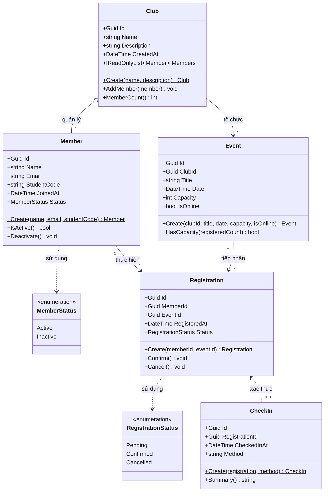
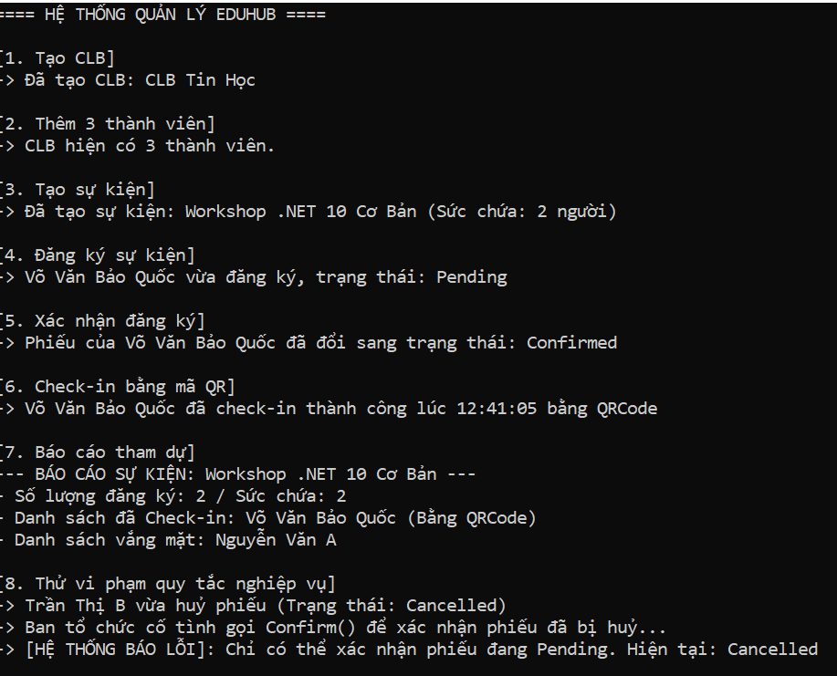

# EduHub — Hệ Thống Quản Lý Câu Lạc Bộ & Sự Kiện Sinh Viên

> **Học phần:** IN4211 — Phát triển phần mềm hướng đối tượng  
> **Giảng viên:** ThS. Nguyễn Tuấn Kiệt  
> **Sinh viên:** Võ Văn Bảo Quốc  
> **Mã số sinh viên:** 0024419350  
> **Lớp:** ĐHCNTT24E-IT  

---

## 1. Phân Tích Yêu Cầu & Danh Sách User Stories (Nhiệm vụ 1)

Hệ thống **EduHub** hỗ trợ quản lý câu lạc bộ (CLB) và sự kiện sinh viên. Dưới đây là các User Story với tiêu chí nghiệm thu (Acceptance Criteria) theo định dạng chuẩn **Given - When - Then**, bao quát đầy đủ 3 nhóm tác nhân (Actors):

### 🎓 Nhóm 1: Tác nhân Sinh viên (Member)

* **US-01: Sinh viên nộp đơn rời câu lạc bộ**
  * *User Story:* Là một thành viên đang tham gia CLB, tôi muốn nộp yêu cầu rời CLB để ngừng tham gia các hoạt động khi không còn phù hợp.
  * *Tiêu chí nghiệm thu:*
    * **Given** sinh viên đang là thành viên chính thức (`Active`) của CLB, **When** sinh viên gửi yêu cầu rời CLB, **Then** hệ thống ghi nhận và chuyển trạng thái đơn sang chờ xác nhận.
    * **Given** sinh viên đã gửi đơn rời CLB và đang chờ xác nhận, **When** gửi tiếp đơn lần hai, **Then** hệ thống từ chối yêu cầu và thông báo đơn đang được xử lý.

* **US-02: Sinh viên huỷ đăng ký tham gia sự kiện**
  * *User Story:* Là sinh viên đã đăng ký sự kiện, tôi muốn huỷ đăng ký trước ngày diễn ra sự kiện để nhường suất tham dự cho sinh viên khác.
  * *Tiêu chí nghiệm thu:*
    * **Given** phiếu đăng ký ở trạng thái `Pending` hoặc `Confirmed` và sự kiện chưa diễn ra, **When** sinh viên bấm huỷ đăng ký, **Then** trạng thái phiếu chuyển thành `Cancelled` và hệ thống tự động hoàn lại một chỗ trống cho sự kiện.
    * **Given** sự kiện đã hoặc đang diễn ra, **When** sinh viên bấm huỷ đăng ký, **Then** hệ thống từ chối huỷ và báo lỗi.

* **US-03: Sinh viên gửi đánh giá sự kiện sau khi tham dự**
  * *User Story:* Là sinh viên đã tham dự sự kiện, tôi muốn gửi phản hồi đánh giá để ban tổ chức cải thiện chất lượng các hoạt động sau.
  * *Tiêu chí nghiệm thu:*
    * **Given** sinh viên đã được điểm danh (`CheckIn`) tại sự kiện đó, **When** gửi form đánh giá, **Then** hệ thống ghi nhận phản hồi thành công.
    * **Given** sinh viên chưa từng được điểm danh tại sự kiện, **When** cố gắng gửi đánh giá, **Then** hệ thống chặn hành động và thông báo chỉ người đã tham dự mới được quyền đánh giá.

---

### 🧑‍💼 Nhóm 2: Tác nhân Ban Chủ Nhiệm CLB

* **US-04: Ban CLB duyệt phiếu đăng ký sự kiện của sinh viên**
  * *User Story:* Là ban chủ nhiệm CLB, tôi muốn duyệt các phiếu đăng ký `Pending` để xác nhận danh sách sinh viên tham dự chính thức.
  * *Tiêu chí nghiệm thu:*
    * **Given** phiếu đăng ký hợp lệ ở trạng thái `Pending` và sự kiện còn chỗ trống (`registeredCount < capacity`), **When** chọn phê duyệt, **Then** phiếu chuyển sang trạng thái `Confirmed`.
    * **Given** sự kiện đã đạt sức chứa tối đa (`capacity`), **When** ban CLB bấm phê duyệt, **Then** hệ thống từ chối và cảnh báo sự kiện đã đủ người.

* **US-05: Ban CLB cập nhật thông tin sự kiện**
  * *User Story:* Là ban tổ chức, tôi muốn chỉnh sửa thời gian hoặc địa điểm sự kiện khi có thay đổi phát sinh.
  * *Tiêu chí nghiệm thu:*
    * **Given** sự kiện chưa đến ngày diễn ra, **When** cập nhật thời gian/địa điểm hợp lệ, **Then** hệ thống lưu thông tin mới và gửi thông báo cập nhật đến các sinh viên đã đăng ký.
    * **Given** sự kiện đã bắt đầu hoặc đã kết thúc, **When** thực hiện thao tác cập nhật, **Then** hệ thống từ chối cho phép thay đổi thông tin.

* **US-06: Ban CLB gửi thông báo nhanh (Broadcast) đến sinh viên tham gia**
  * *User Story:* Là ban tổ chức, tôi muốn phát thông báo đến toàn bộ sinh viên đã xác nhận tham dự sự kiện để nhắc nhở lịch trình.
  * *Tiêu chí nghiệm thu:*
    * **Given** người thao tác thuộc ban quản trị CLB tổ chức sự kiện và sự kiện chưa kết thúc, **When** gửi nội dung thông báo, **Then** hệ thống gửi thông báo đến danh sách sinh viên có phiếu `Confirmed`.
    * **Given** tài khoản không thuộc ban quản lý CLB, **When** thực hiện gửi broadcast, **Then** hệ thống từ chối và báo lỗi không có quyền truy cập.

---

### 🛠️ Nhóm 3: Tác nhân Quản Trị Viên (Admin)

* **US-07: Quản trị viên ngừng tư cách hoạt động của thành viên**
  * *User Story:* Là quản trị viên hệ thống, tôi muốn ngừng kích hoạt thành viên vi phạm nội quy để đảm bảo kỷ luật cho các hoạt động của câu lạc bộ.
  * *Tiêu chí nghiệm thu:*
    * **Given** thành viên đang ở trạng thái hoạt động (`Active`), **When** admin chọn ngừng hoạt động (`Deactivate`), **Then** thuộc tính `Status` chuyển thành `Inactive` nhưng toàn bộ lịch sử đăng ký trước đó vẫn được lưu giữ trọn vẹn.
    * **Given** thành viên đã ở trạng thái `Inactive`, **When** admin thao tác, **Then** hệ thống thông báo trạng thái hiện tại không đổi.

---

## 2. Sơ Đồ Lớp — Class Diagram (Nhiệm vụ 2)

Sơ đồ lớp mô hình hoá 5 thực thể chính của hệ thống EduHub, tuân thủ nguyên tắc đóng gói (Encapsulation), khóa chính duy nhất (`Guid`), khóa ngoại liên kết và phương thức tạo tĩnh `Create(...)`:

---

## 3. Kiến Trúc & Thiết Kế Thực Thể Domain (Nhiệm vụ 3)

* **Encapsulation (Đóng gói dữ liệu):**
  * Tất cả các thuộc tính của các lớp thực thể đều sử dụng `get; private set;` để ngăn chặn việc sửa đổi dữ liệu tùy tiện từ bên ngoài.
  * Constructor được đánh dấu `private`, chỉ cho phép khởi tạo đối tượng thông qua static factory method `Create(...)`.
* **Validation (Kiểm tra dữ liệu):**
  * Phương thức `Create(...)` tự động thẩm định dữ liệu đầu vào (chuỗi không rỗng, email chứa ký tự `@`, sức chứa `capacity > 0`). Nếu vi phạm sẽ chủ động ném ngoại lệ (`ArgumentException`, `ArgumentOutOfRangeException`).
* **Quản lý quan hệ trong Domain:**
  * Lớp `Club` đóng gói danh sách thành viên qua `IReadOnlyList<Member>`, chỉ cho phép thêm thành viên thông qua hàm nghiệp vụ `AddMember(...)` có kiểm tra chống trùng lặp `Id`.

---

## 4. Kịch Bản Chạy Demo Console (Nhiệm vụ 4)

Chương trình trong file `Program.cs` mô phỏng đầy đủ chu trình nghiệp vụ 7 bước chuẩn cùng bước kiểm thử vi phạm quy tắc:

1. **Bước 1:** Khởi tạo Câu lạc bộ Công nghệ Thông tin (`Club.Create`).
2. **Bước 2:** Khởi tạo 3 thành viên sinh viên (`Member.Create`) và thêm vào CLB (`AddMember`).
3. **Bước 3:** Tạo sự kiện Workshop SOLID (`Event.Create`).
4. **Bước 4:** Thành viên đăng ký tham gia sự kiện (`Registration.Create`, trạng thái mặc định `Pending`).
5. **Bước 5:** Ban tổ chức xác nhận phiếu đăng ký (`registration.Confirm`, chuyển sang `Confirmed`).
6. **Bước 6:** Sinh viên điểm danh tại sự kiện qua phương thức QR / Thủ công (`CheckIn.Create`).
7. **Bước 7:** Xuất báo cáo thống kê tình hình tham dự sự kiện.
8. **Bước 8 (Thử nghiệm vi phạm nghiệp vụ):** Thực hiện huỷ một phiếu đăng ký (`Cancel`), sau đó thử gọi `Confirm()` trên phiếu đã huỷ để chứng minh hệ thống chặn vi phạm và bắt đúng `InvalidOperationException`.

### Ảnh chụp kết quả thực thi:
